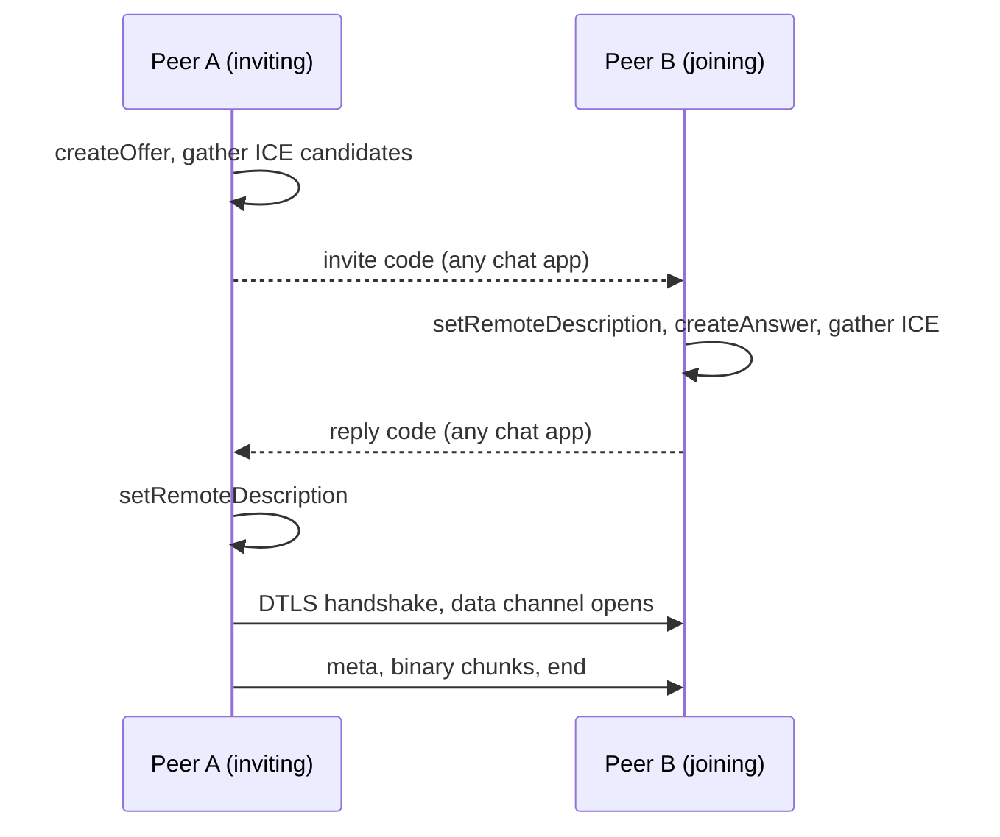

# Vaultlink

Direct, encrypted, browser-to-browser file transfer. No upload, no account, no signaling server.

**Live:** https://vaultlink.onrender.com

Vaultlink opens a real WebRTC `RTCDataChannel` between two browsers and streams files across it. Connection setup is a manual copy-paste of two codes through any chat app, so there is no backend of any kind. Everything is plain HTML, CSS, and JavaScript.

## Features

- Direct peer-to-peer transfer over WebRTC data channels
- End-to-end encryption through automatic DTLS
- Manual SDP exchange: no signaling server, no accounts, no tracking
- Chunked sending with backpressure, so large files do not freeze the page
- Automatic download on the receiving side, with a log and "Save again" links
- Live connection status driven by the real `RTCPeerConnection.connectionState`
- Warns when opened from `file://`, where WebRTC is blocked
- Three source files, no framework, no bundler, no build step

## How it works



1. Peer A clicks **Create invite** and sends the code to Peer B.
2. Peer B pastes it under **I'm joining**, clicks **Generate reply**, and sends the reply code back.
3. Peer A pastes the reply and clicks **Finish connection**.
4. Status turns green. Either side can now drop files and click **Send files**.

## Quick start

WebRTC requires a secure context, so serve the folder instead of opening `index.html` directly.

```bash
git clone https://github.com/procodernoone/vaultlink.git
cd vaultlink
python3 -m http.server 8000
```

Open `http://localhost:8000` in two tabs or two browsers and follow the flow above.

## Transfer protocol

All traffic uses one ordered data channel named `vaultlink`.

| Message | Type | Content |
| --- | --- | --- |
| `meta` | text (JSON) | `id`, `name`, `size`, `mime` |
| chunk | binary | up to 16 KiB of file data |
| `end` | text (JSON) | `id` |

The sender reads 256 KiB slices from the `File`, splits them into 16 KiB messages, and pauses whenever `bufferedAmount` exceeds 1 MiB until `bufferedamountlow` fires. The receiver assembles chunks into a `Blob` and downloads it through an `<a download>` link.

## Security model

- Data channels are encrypted with DTLS by the browser. Vaultlink adds no server that can see file data.
- The invite and reply codes contain the DTLS fingerprints and network candidates. Anyone who can intercept and replace a code during exchange could attempt to impersonate a peer, so send codes only through a channel you trust.
- Public STUN servers (Google, Cloudflare) are used only so each browser can learn its public address. They never see file data or codes.
- Received files are held in memory until the transfer finishes, so very large files are bounded by the receiver's RAM.

## Networks and TURN

Most home and mobile networks connect with STUN alone. Strict firewalls and symmetric NATs can block direct paths, and the status shows `Connection failed`. A TURN relay is the one case where a server is unavoidable. Add one to `RTC_CONFIG` in `app.js`:

```js
const RTC_CONFIG = {
  iceServers: [
    { urls: 'stun:stun.l.google.com:19302' },
    { urls: 'turn:your.host:3478', username: 'user', credential: 'secret' }
  ]
};
```

Data stays end-to-end encrypted through a TURN relay.

## Browser support

Current Chrome, Firefox, Safari, and Edge on desktop and mobile.

## Project structure

```
index.html            markup, metadata, structured data
style.css             all styling
app.js                WebRTC, signaling codes, chunked transfer, UI
robots.txt
sitemap.xml
favicon.ico
apple-touch-icon.png
logo.webp
og-image.png
```

## Deploy

Any static host works. On Render: create a **Static Site**, leave the build command empty, and set the publish directory to `.`. Static hosts on `https://` satisfy the secure-context requirement.

## Author

Made by [MD. Abir Hossain Shwapno](https://abir-hossain-shwapno.onrender.com) ([GitHub](https://github.com/procodernoone)).